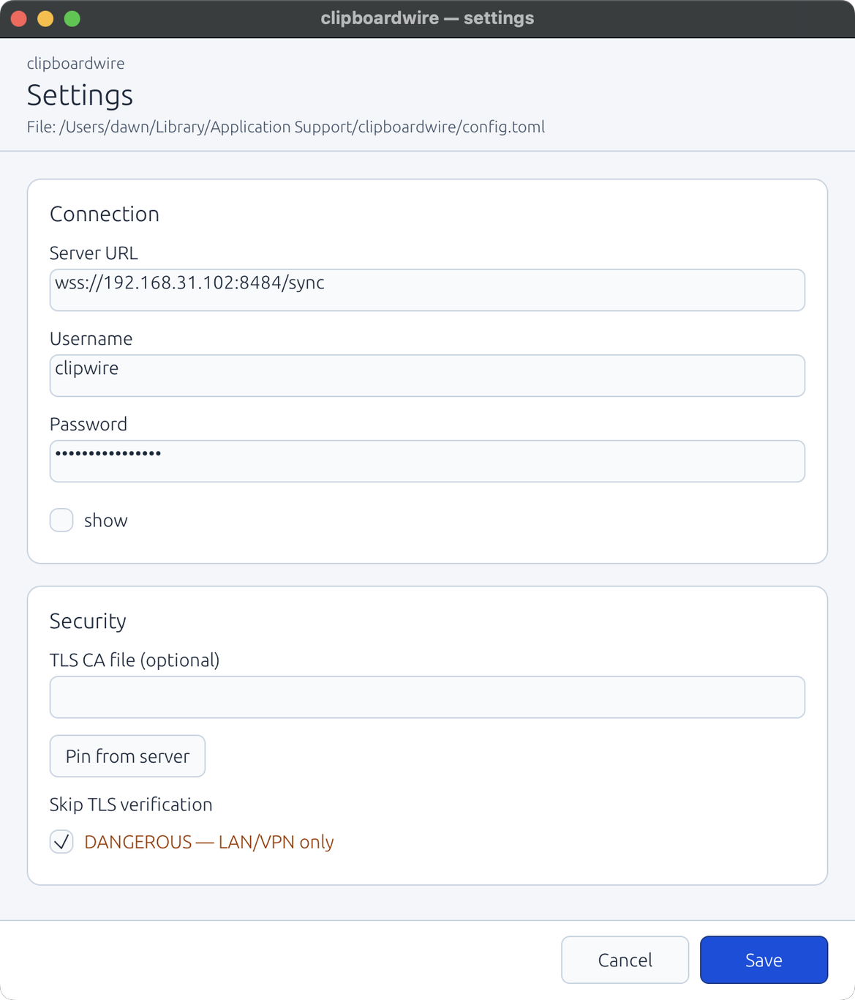

# clipboardwire

> Cross-platform clipboard sync over WebSocket. One small Rust binary. Runs on Linux + Windows + MacOS. LAN/VPN-first.

[](https://github.com/xixijay1988/clipboardwire/actions/workflows/ci.yml)
[](https://github.com/xixijay1988/clipboardwire/releases/latest)
[](LICENSE)

Copy on one machine, paste on another. Text, images and files. No cloud account, no
SaaS, no JVM — just a ~14 MiB static binary that runs as a tray icon and shuttles
clipboard contents between your trusted devices over an encrypted WebSocket.

This is a fork of [davefx/clipboardwire](https://github.com/davefx/clipboardwire),
which started as a Rust rewrite of the [ClipCascade] server (Java/Spring). This
fork adds lazy file transfer (`send_mode`/`receive_mode`), paste-time file
delivery on Windows **and** macOS, a redesigned settings UI, and assorted
robustness fixes around reconnects, replays, and concurrent clipboard holders.

<table>
  <tr>
    <td align="center">
      <br/>
      <sub>Right-click menu: live status, hub controls, quick config access.</sub>
    </td>
    <td align="center">
      <br/>
      <sub>Hover tooltip: current state + the server it's pointed at.</sub>
    </td>
  </tr>
  <tr>
    <td colspan="2" align="center">
      <br/>
      <sub>Settings dialog: a GUI for the config TOML, no editor required.</sub>
    </td>
  </tr>
</table>

[ClipCascade]: https://github.com/Sathvik-Rao/ClipCascade

---

## What you get

- **One binary, three modes.** `clipboardwire` (or any of `connect` / `host` /
  `serve`) — the right mode is the default depending on how you launched it.
- **System-tray app** with live connection status (Connecting / Connected /
  Disconnected — retrying in N s), a Settings GUI, and Start/Stop/Restart
  controls for the embedded hub. Runs on Linux (X11 + Wayland via GTK +
  libayatana-appindicator), Windows, and macOS (menu-bar app, no Dock entry).
- **File sync via the clipboard — lazy by default.** Ctrl+C a file
  (or several) in Explorer / Finder / Nautilus on one machine and the
  sender only publishes a metadata *offer* — no bytes move yet. What
  happens next is the receiver's `receive_mode`:
  - `paste` — a clipboard promise is armed and the bytes are pulled
    **when you Ctrl+V**, verified against the sender's SHA-256
    mid-copy. Windows uses OLE delayed rendering; macOS uses an
    `NSFilePresenter` placeholder the Finder waits on. A failed pull
    surfaces as a copy error, not an empty file.
  - `pickup` — offers are fetched the moment they arrive and land in
    `~/Downloads/clipboardwire/`.
  - `eager` — classic behaviour: chunks flow at copy time.
  - `auto` — resolves per platform (today: `pickup` on Windows/macOS).

  Multi-file selections arrive as one clipboard set. There's also a
  `clipboardwire send <FILE>` CLI for scripted transfers.
- **Auto-TLS by default.** First time the hub starts it generates a
  self-signed cert under `~/.config/clipboardwire/` (or the platform
  equivalent) with sensible SANs and logs the SHA-256 fingerprint. Clients
  pin it via `tls_ca_file` or skip verification with `tls_insecure = true`
  on a trusted network.
- **Embedded-hub mode.** Your always-on workstation can both *be* the
  relay and a clipboard participant — no separate `serve` install needed.
- **Packaged builds.** Releases ship a universal macOS `.dmg` /
  `.app.tar.gz` and a Windows `.exe` — one self-contained binary
  either way. Linux users build from source.
- **Tests, not vibes.** Tier-1 smoke tests, Linux DBus-driven menu
  interaction tests, Windows UI-Automation tray-discovery tests,
  egui_kittest UI tests for the Settings dialog, an integration test
  that proves the singleton-lock catches duplicate launches. CI runs all
  of them on Linux and Windows on every push.

## Install

This fork's releases ship macOS (`.dmg` / `.app.tar.gz` / bare binaries)
and a Windows `.exe`. Linux users build from source — see
[Building from source](#building-from-source); for upstream-style distro
packages use [davefx/clipboardwire](https://github.com/davefx/clipboardwire).

### Windows

Download `clipboardwire-windows-x86_64.exe` from the
[latest release](https://github.com/xixijay1988/clipboardwire/releases/latest)
and run it — it's the same single binary: double-clicking starts the tray
app. For login autostart add a `HKCU\Run` entry or a shortcut in
`shell:startup`.

### macOS

Grab the DMG from the latest release:

```sh
curl -LO https://github.com/xixijay1988/clipboardwire/releases/latest/download/clipboardwire-macos-universal.dmg
hdiutil attach clipboardwire-macos-universal.dmg
cp -R "/Volumes/clipboardwire/clipboardwire.app" /Applications/
hdiutil detach "/Volumes/clipboardwire"
open /Applications/clipboardwire.app
```

The binary is unsigned, so the first launch shows a "cannot verify
developer" warning. Open *System Settings → Privacy & Security*,
scroll to the bottom, and click *Open Anyway*. clipboardwire lives
in the menu bar (LSUIElement) — no Dock icon.

### Cargo (any platform with Rust 1.89+)

```sh
cargo install --git https://github.com/xixijay1988/clipboardwire --locked clipboardwire
```

You'll need the GTK / libayatana-appindicator dev headers on Linux. See
[Building from source](#building-from-source).

## Quick start (one machine hosts, others connect)

On the machine that should run the relay:

1. Launch `clipboardwire`. On first run the Settings dialog opens.
2. Fill in **Server URL** (`wss://<this-host>:8484/sync`), a username, a
   password.
3. Expand **Run hub on this machine**, tick **Run hub when the tray starts**,
   re-enter the same username/password for the hub auth, and choose a bind
   address (default `0.0.0.0:8484`).
4. Save. The tray menu now shows **Status: connecting…** then
   **Status: connected**.

On each other device:

1. Install + launch. Settings dialog opens.
2. Fill in the same **Server URL** + username + password from above. Leave
   the hub section unticked.
3. For the self-signed cert: either copy the host's
   `~/.config/clipboardwire/self-signed.crt` over to the same path on the
   client and set `tls_ca_file` in `config.toml`, or — only on a trusted
   network — tick **Skip TLS verification**.
4. Save. Tray should show **Status: connected**.

Now copy on one device and paste on another.

## Configuration

The client config lives at:

- Linux: `~/.config/clipboardwire/config.toml`
- macOS: `~/Library/Application Support/clipboardwire/config.toml`
- Windows: `%APPDATA%\clipboardwire\config.toml`

The Settings GUI covers every field, but the underlying TOML is small and
hand-editable:

```toml
server = "wss://nas.lan:8484/sync"
user = "alice"
password = "hunter2"
poll_ms = 300
# tls_ca_file = "/path/to/self-signed.crt"  # pin a specific cert
# tls_insecure = true                       # LAN/VPN only

send_mode = "lazy"        # "lazy" publishes file metadata on copy;
                          # "eager" streams bytes immediately
receive_mode = "auto"     # "auto" | "paste" | "pickup" | "eager"
                          # paste: pull when the shell pastes (Windows, macOS)
                          # pickup: fetch every offer into ~/Downloads/clipboardwire
                          # eager: ignore offers, eager chunks only

# Optional: bring up a hub server in this same process. Other devices
# on your network connect to <bind>; the local client routes over
# loopback automatically.
[hub]
enabled = true
bind = "0.0.0.0:8484"
user = "alice"
password = "hunter2"
# tls_disabled = true     # serve plain ws:// instead of auto-gen TLS
```

`clipboardwire serve` reads the same TOML's `[hub]` section, so a
headless NAS install only needs one file.

## How it works

```
+--------------+         wss://         +--------------+         wss://         +--------------+
|              | <--------------------> |              | <--------------------> |              |
|  client A    |   (one TCP conn)       |   the hub    |   (one TCP conn)       |  client B    |
|  (tray + arb) |  Basic auth + JSON     | (in-memory   |  Basic auth + JSON     |  (tray + arb) |
|              |                        |  fan-out)    |                        |              |
+--------------+                        +--------------+                        +--------------+
        ^                                                                              ^
        |                                                                              |
   local clipboard                                                              local clipboard
   (arboard)                                                                    (arboard)
```

- The **hub** is a [tokio](https://tokio.rs) + [axum](https://github.com/tokio-rs/axum)
  WebSocket relay. Each connected client gets a UUID; when one client publishes a
  clip frame, the hub broadcasts to every other client and caches it as the
  "last clip" so late joiners get the current value in their welcome frame.
- Each **client** runs a polling thread on top of [arboard](https://github.com/1Password/arboard)
  to detect local clipboard changes, a tokio WebSocket task for the wire, and a
  supervisor that bridges them with echo-loop suppression.
- The **tray** owns the main thread for the OS event loop ([tao](https://github.com/tauri-apps/tao))
  while tokio runs on worker threads. The Settings dialog is a separate
  `clipboardwire settings` subprocess that uses [eframe/egui](https://github.com/emilk/egui)
  so the two event loops don't fight.

The wire protocol is documented in [PROTOCOL.md](PROTOCOL.md). The implementation
plan and trade-offs are in [ARCHITECTURE.md](ARCHITECTURE.md).

## Threat model

The α model assumed by the code:

- **Trusted:** your devices, the hub host (operator, RAM, disk).
- **Untrusted:** the network path between devices and the hub. TLS via
  `rustls` is what protects clipboard contents in transit. The hub
  auto-generates a self-signed cert on first run; clients have to either
  pin it (`tls_ca_file`) or — only on a trusted network — set
  `tls_insecure = true`.
- **Out of scope:** denial-of-service, side channels on the client devices,
  end-to-end encryption from one client to another (the hub sees clipboard
  plaintext).
- **Not for:** clipboard sync over the public internet to untrusted
  infrastructure. The right upgrade path for that is E2EE with TOFU
  device pairing — see PROTOCOL.md §4 for the sketch.

If you find a vulnerability, see [SECURITY.md](SECURITY.md).

## Building from source

You need Rust 1.89 or newer. Linux additionally needs the GTK +
libayatana-appindicator + libxdo development headers (for the tray icon):

```sh
# Debian / Ubuntu
sudo apt install libgtk-3-dev libayatana-appindicator3-dev libxdo-dev

# Fedora / RHEL
sudo dnf install gtk3-devel libayatana-appindicator-gtk3-devel libxdo-devel

# Then:
cargo build --release -p clipboardwire
./target/release/clipboardwire
```

Test suite:

```sh
cargo test --workspace                                  # unit + integration
xvfb-run -a cargo test --workspace -- --ignored        # tray + DBus + UIA
```

## Status & roadmap

Currently shipping: **v0.5.6** — see [CHANGELOG.md](CHANGELOG.md).

Highlights of this fork's line:

- **v0.5.5** — lazy file transfer on the wire: `file_offer` /
  `file_pull` frames, resumable chunked pulls, `send_mode` /
  `receive_mode`, and paste-time rendering on Windows via OLE
  `IDataObject` + `IStream` with byte-level progress.
- **v0.5.6** — settings UI redesign, and a local copy now survives
  reconnects, replays, and peer churn.
- **unreleased (main)** — `receive_mode = "paste"` on macOS: offers
  arm `file://` placeholders under `$TMPDIR` registered through
  `NSFileCoordinator`/`NSFilePresenter`, so Finder's Cmd+V blocks on
  a coordinated read until the pull is verified — and reports error
  -43 on failure instead of copying an empty file.

Still on the list for later patches:

- Flip `receive_mode = "auto"` to `paste` on macOS once the
  presenter path has soaked (today `auto` → `pickup`).
- Byte-level progress for macOS paste — needs an `NSFileProvider`
  extension (signed bundle + XPC + user opt-in); the presenter
  mechanism only gives Finder an indeterminate "preparing" state.
- Native Wayland file-clipboard via `wl_data_device` (Xwayland
  already covers most setups, so the urgency is low).
- End-to-end encryption between peers — for a deployment shape
  where the hub is on hardware you don't trust (the current
  threat model assumes the hub is in the trust boundary).

## Contributing

Issues and PRs welcome on [GitHub](https://github.com/xixijay1988/clipboardwire).
The codebase is a workspace: `core/` is the library (protocol, hub, client
transport, clipboard adapter), `cli/` is the binary (tray, settings, CLI
plumbing). Tests are the contract — please add one for any non-trivial
change. Run `cargo fmt --all -- --check` and `cargo clippy --workspace
--all-targets -- -D warnings` before sending.

## License

[GPL-3.0-or-later](LICENSE).
